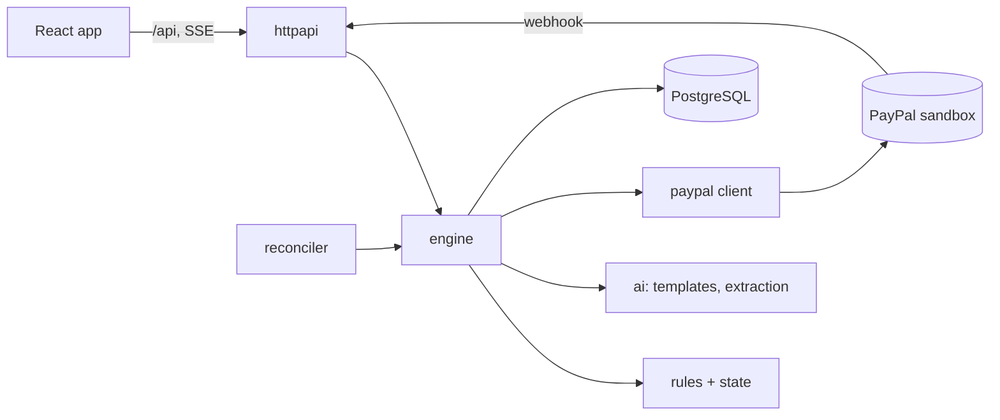
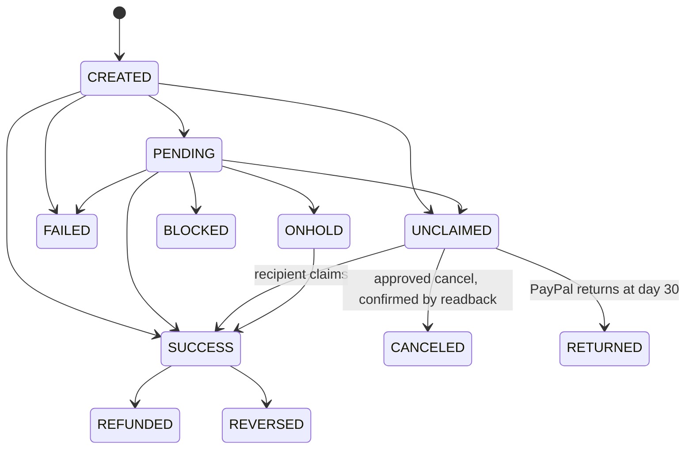

# Architecture

One Go service: HTTP API, webhook receiver, reconciler and the embedded React app. PostgreSQL is the only datastore.

## Item state machine

`FAILED`, `RETURNED` and `CANCELED` are the only states from which a replacement may be created ("reissue-safe"). A readback that asks for an impossible transition is ignored, flagged for review and audited.

## Invariants (enforced in code, covered by tests)

1. **At most one live item per logical payout.** A partial unique index (`one_live_item_per_payout`) makes a second one impossible even if application code is wrong.
2. **A replacement follows a confirmed-dead original.** The original is read back from PayPal at approval time; webhooks and cached state are never trusted for this.
3. **Replacements use deterministic ids** (`sender_batch_id`, `sender_item_id`, `PayPal-Request-Id` derived from the payout and attempt number). A crash or lost response is retried with the same ids, so PayPal replays instead of creating a second payout.
4. **No money-moving action runs without a recorded, named approval.** Cancel and replace are the only money-moving kinds.
5. **Webhook handling is idempotent.** Events are stored once by id; the item is read back before state changes.
6. **AI never decides.** It drafts text and extracts an email, a currency, a refusal and an injection flag. It cannot approve, call PayPal, or supply an amount or currency.
7. **Fail closed.** An inconclusive readback changes nothing and flags the item.

## Replace flow (the dangerous one)

1. Operator approves. The approval is recorded and audited.
2. Fresh readback of the original; apply through the state machine.
3. Re-check: original is FAILED, RETURNED or CANCELED; attempt limit; corrected email valid.
4. One transaction reserves the replacement batch and item. The unique index rejects it if any live item exists.
5. Send with the deterministic request id. A 5xx or lost response leaves the action `approved`; the reconciler resumes it with the same ids.
6. Read the replacement back; mark the action executed.

## Failure modes

| Failure | Behaviour |
|---|---|
| Webhook duplicated, delayed, reordered, or missing | Stored once; readback wins over payload; reconciler recovers missing events |
| PayPal 5xx or timeout on create | Same ids retried; no second payout |
| Response lost after PayPal created the batch | Retry replays the same batch |
| Recipient claims during a cancel approval | Readback shows SUCCESS; cancel refused; no replacement |
| Reply contains instructions or an amount | Blocked by a deterministic guard before any model call; item flagged |
| Model unavailable or returns bad JSON | Deterministic extraction and templates |
| PayPal reports an unknown error code | Escalated, never retried |

## Data model

`logical_payouts` (the obligation) -> `payout_items` (each send attempt, `attempt`, `original_item_id`) -> `payout_batches`. `webhook_events` (unique event id), `actions` (proposed, approved, executed, rejected, failed; unique idempotency key), `messages`, `audit_log` (append-only, hash-chained, protected by a trigger), `bench_runs`.

## Modes

Every batch and item is labelled `LIVE_SANDBOX` (real sandbox), `SIMULATED` (PayPal's canned test-value responses, which do not change real state) or `FAKE` (in-memory stand-in). The label appears in the UI and in the benchmark and is never mixed silently.

## Conflicts

A conflict is a payout where the evidence disagrees or a person must decide. They are opened by detectors in the engine (never by the UI) and deduplicated by a `dedupe_key`:

| Kind | Opened when | Allowed resolutions |
|---|---|---|
| `claim_race` | A cancel or replacement was refused, or withdrawn, because the item became SUCCESS | acknowledge |
| `ambiguous_reply` | A reply contained more than one email | use_email (one of the candidates), ask_again, dismiss |
| `email_same_as_on_file` | The "corrected" email is the one already on file | ask_again, dismiss |
| `refusal_vs_proposal` | The recipient refuses while a cancel or replacement is proposed | withdraw_proposals, keep_proposals (note required) |
| `held_with_correction` | ONHOLD or BLOCKED, yet a corrected email exists | wait, escalate |
| `attempts_exhausted` | The last attempt is dead and a corrected email exists | close_unpaid, paid_manually (note required) |
| `status_disagreement` | PayPal reported an illegal transition | refresh_now (only if now consistent), accept_and_close |

**Resolutions never move money.** They may record a validated email, withdraw a proposal, draft a message, create an ordinary proposal (which still needs its own approval), or close the case. Every resolution needs a named approver and is audited as `conflict_resolved`. Stale proposals (a cancel whose payout was claimed) are rejected by the system as `action_superseded`.

## Generated documentation

`GET /api/reference` returns the registered routes (each registered together with its description), the conflict resolutions and a rules matrix produced by running `rules.Decide` over every situation. `GET /api/demo/payouts` returns the demo packs from `internal/demo`. The Help page renders these, so it cannot drift from the code.
