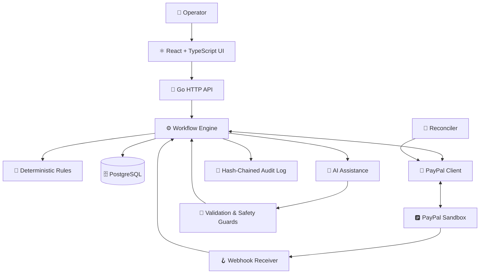

# 🛡️ PAYOUTRESCUE

### 🚀 RESCUE. RECONCILE. RESOLVE.

**The Intelligent PayPal Payout Recovery & Safety Platform**

> Turning failed payouts into actionable workflows — with AI assistance, deterministic safety rules, and human-approved financial actions.


**Built for the PayPal AI Hackathon 2026**

---

## 🌟 THE VISION

**PayoutRescue is a post-send control room for PayPal Payouts.**

Payout failures create operational friction. Teams must investigate errors, communicate with recipients, reconcile delayed updates, and determine whether a payout is safe to retry.

PayoutRescue brings these workflows into one interface.

| 🔴 THE CHALLENGE | 🟢 THE APPROACH |
|---|---|
| Failed or delayed payouts | Clear status explanations and actionable recommendations |
| Confusing provider errors | Plain-language guidance and deterministic rules |
| Risk of duplicate payments | Idempotency, fresh status checks, and database constraints |
| Repetitive recipient communication | AI-assisted message drafting and reply interpretation |
| Difficult investigations | Timelines, conflict workflows, and an audit trail |

---

## 💎 WHAT MAKES PAYOUTRESCUE DIFFERENT?

### 🧠 AI ASSISTANCE + DETERMINISTIC CONTROL

AI helps operators understand recipient replies and draft communication. It does **not** independently authorize money movement.

### 🔒 SAFETY BEFORE ACTION

Every proposed money-moving action passes through the application's safety workflow and requires human approval.

### 🔁 RECONCILIATION BY DESIGN

Webhooks and periodic reconciliation help the system recover from missed or delayed updates.

### 📊 OPERATIONAL VISIBILITY

Operators can inspect payout states, recommendations, timelines, conflicts, and audit history in one place.

---

## ✨ FEATURE MATRIX

| Feature | Description |
|---|---|
| 🔎 **Payout Tracking** | Track payout batches and individual item statuses. |
| 🚨 **Failure Intelligence** | Translate payout errors into explanations and recommended next steps. |
| 🧠 **AI Communication Assistant** | Draft recipient messages and help interpret replies. |
| 🔐 **Human Approval Workflow** | Keep money-moving decisions under operator control. |
| ♻️ **Duplicate-Payment Safeguards** | Combine deterministic request IDs, readbacks, and database constraints. |
| 🔄 **Reconciliation Engine** | Recheck provider state to help recover missed updates. |
| 🧾 **Audit Trail** | Maintain a hash-chained record of workflow activity. |
| ⚔️ **Conflict Resolution** | Investigate ambiguous or conflicting payout situations. |
| 📥 **CSV Batch Import** | Preview and validate imported payout data. |
| ⚡ **Operator Productivity** | Keyboard shortcuts, command palette, notes, snoozing, and reports. |

---

## 🚦 PAYOUT STATUS INTELLIGENCE

PayoutRescue supports workflows involving statuses such as:


The application maps documented error names to explanations and rule-based recommendations. Exact provider behavior must still be verified against the PayPal sandbox.

---

## 🛡️ SECURITY & SAFETY ARCHITECTURE

**Financial workflows require safeguards, not just suggestions.**

- 🔐 **Sandbox lock:** startup refuses a non-sandbox PayPal base URL.
- 👤 **Human approval:** money-moving actions require a named approver.
- 🔍 **Fresh readbacks:** replacement workflows check the provider's current state.
- 🔁 **Idempotent retries:** deterministic request IDs help retries reuse the same operation.
- 🗄️ **Database constraints:** enforce the configured one-live-item-per-payout invariant.
- 🧠 **AI boundaries:** deterministic validation and safety checks constrain model-assisted workflows.
- 🧾 **Auditability:** workflow activity is recorded in a hash-chained audit log.
- 🪝 **Webhook verification:** signature verification is used for real events when configured.

> ⚠️ **SANDBOX ONLY — NO REAL MONEY MOVES.** These safeguards do not imply that every possible provider failure has been tested.

---

## ⚡ GET STARTED IN MINUTES

### 🐳 OPTION 1 — DOCKER COMPOSE

```bash
docker compose up --build
```

Open **http://localhost:8080**

Then:

1. 🔑 Use the development token: `dev-token`
2. 📊 Click **Load demo data**
3. ⚔️ Click **Load conflict pack**
4. 🔎 Open a payout to inspect its status and recommendations
5. 🧪 Explore recipient-reply presets and setup controls

### 💻 OPTION 2 — LOCAL DEVELOPMENT

Start PostgreSQL 16 in Docker, then run:

```bash
make db
make run
```

The application builds the UI and serves it on port `8080`.

**Fake mode works without PayPal credentials.**

---

## 🅿️ PAYPAL SANDBOX INTEGRATION

To test provider integration:

1. Create a sandbox Business account and sandbox app in the PayPal Developer Dashboard.
2. Enable Payouts if available for the app.
3. Configure `PAYPAL_CLIENT_ID` and `PAYPAL_CLIENT_SECRET`.
4. Run the connection check:

   ```bash
   make check
   ```

5. Configure the webhook endpoint:

   ```text
   PUBLIC_BASE_URL/api/webhooks/paypal
   ```

6. Register payout batch and item events, then configure `PAYPAL_WEBHOOK_ID`.

**Simulator note:** simulator events cannot be verified through PayPal's verification endpoint. `WEBHOOK_BYPASS=true` is an explicit simulator-only testing option and displays a warning banner.

---

## 🏗️ SYSTEM ARCHITECTURE



### 🧩 TECHNOLOGY STACK

| Layer | Technology |
|---|---|
| Backend | Go |
| Frontend | React, TypeScript, Vite, Tailwind CSS |
| Database | PostgreSQL |
| Provider Integration | PayPal Payouts API |
| AI Assistance | Provider abstraction, templates, validated extraction |
| Runtime | Docker |
| Live Updates | Server-Sent Events |
| Testing | Go tests, race detector, TypeScript checks, ESLint |

---

## ⚙️ CONFIGURATION

| Environment variable | Purpose |
|---|---|
| `DATABASE_URL` | PostgreSQL connection string |
| `ADMIN_TOKEN` | API authentication; required in production |
| `PORT` | HTTP server port; defaults to `8080` |
| `APP_ENV` | Application environment |
| `PAYPAL_BASE_URL` | PayPal sandbox API URL |
| `PAYPAL_CLIENT_ID` | Sandbox client ID |
| `PAYPAL_CLIENT_SECRET` | Sandbox client secret |
| `PAYPAL_WEBHOOK_ID` | Webhook signature verification |
| `WEBHOOK_BYPASS` | Explicit simulator-testing bypass |
| `FAKE_ENABLED` | Enable the in-memory provider stand-in |
| `LLM_PROVIDER` | AI provider selection |
| `LLM_API_KEY` | AI provider API key |
| `LLM_MODEL` | AI model name |
| `PUBLIC_BASE_URL` | Public application URL |
| `RECONCILE_INTERVAL_SECONDS` | Reconciliation interval |

**Never commit credentials or `.env` files containing secrets.**

---

## 🧪 TESTING & BENCHMARKS

Run the test suite:

```bash
make test
```

Run the benchmark:

```bash
make bench
```

The benchmark contains **39 scripted scenarios** comparing a naive retry script with PayoutRescue.

The tests include a randomized **“never pay twice”** run covering late claims, lost responses, duplicate webhooks, corrections, and approvals.

**Benchmark disclaimer:** results are scenario-based, not real-world performance measurements. The manual-step baseline is an assumption, and the reply-reading cases were authored alongside the code rather than independently evaluated.

---

## ✅ VERIFICATION STATUS

### Verified in the repository

- Go unit and integration tests against PostgreSQL
- HTTP API
- Embedded frontend
- Benchmark harness
- TypeScript checks and linting

### Requires PayPal sandbox verification

- Real unregistered-recipient `UNCLAIMED` behavior
- Exact responses for all simulator test values
- End-to-end webhook signature verification
- Sandbox app Payouts enablement
- Exact invalid-email error naming

See `docs/SPIKE.md` for the initial verification plan. Unconfirmed behavior is marked `TODO(verify)` in the code.

---

## ☁️ DEPLOYMENT — RENDER

1. Push the project to GitHub.
2. Create a Render Blueprint from the repository.
3. Review `render.yaml` to configure the Docker service and PostgreSQL database.
4. Configure the required secrets and retrieve the generated `ADMIN_TOKEN`.
5. Set `PUBLIC_BASE_URL` to the deployed service URL.
6. Configure the PayPal webhook and `PAYPAL_WEBHOOK_ID`.
7. Run the smoke tests.

### 🔍 Deployment checklist

- [ ] `/healthz` returns HTTP 200.
- [ ] `/readyz` returns HTTP 200.
- [ ] The UI loads and deep-link refreshes work.
- [ ] Demo data loads successfully.
- [ ] A real sandbox webhook appears in the audit log.
- [ ] Repeated replacement approval does not create a second payout.

---

## 🧰 TROUBLESHOOTING

| Problem | Solution |
|---|---|
| Server refuses to start | Ensure `PAYPAL_BASE_URL` points to the sandbox. |
| Live or Simulated modes are disabled | Configure sandbox client credentials. |
| Webhook returns `401` | Check `PAYPAL_WEBHOOK_ID` and webhook verification settings. |
| UI is blank after running Go | Build the frontend with `make web`. |
| Database connection fails | Check `DATABASE_URL` and the appropriate TLS setting. |

---

## 📂 PROJECT STRUCTURE

```text
cmd/
  server/          Application entry point
  check/            PayPal connection checker
  bench/            Benchmark runner

internal/
  state/            Statuses, transitions, invariants
  rules/             Error mapping and recommendations
  paypal/            PayPal Payouts client
  fakepaypal/        In-memory provider simulator
  store/             PostgreSQL and audit log
  engine/            Workflow and reconciliation engine
  ai/                Templates and validated extraction
  httpapi/           API, webhooks, SSE, SPA serving
  bench/             Benchmark scenarios

web/                 React + TypeScript frontend
```

### 📚 PROJECT DOCUMENTATION

- `ARCHITECTURE.md` — state machine, invariants, and failure modes
- `AGENTS.md` — safe development guidelines
- `docs/SPIKE.md` — PayPal sandbox verification plan

---

## 📜 LICENSE

**MIT License**

Sandbox-only project. Not affiliated with or endorsed by PayPal.

---

### 💙 BUILT WITH A SAFETY-FIRST MINDSET

**PayoutRescue — making payout recovery clearer, safer, and more accountable.**
